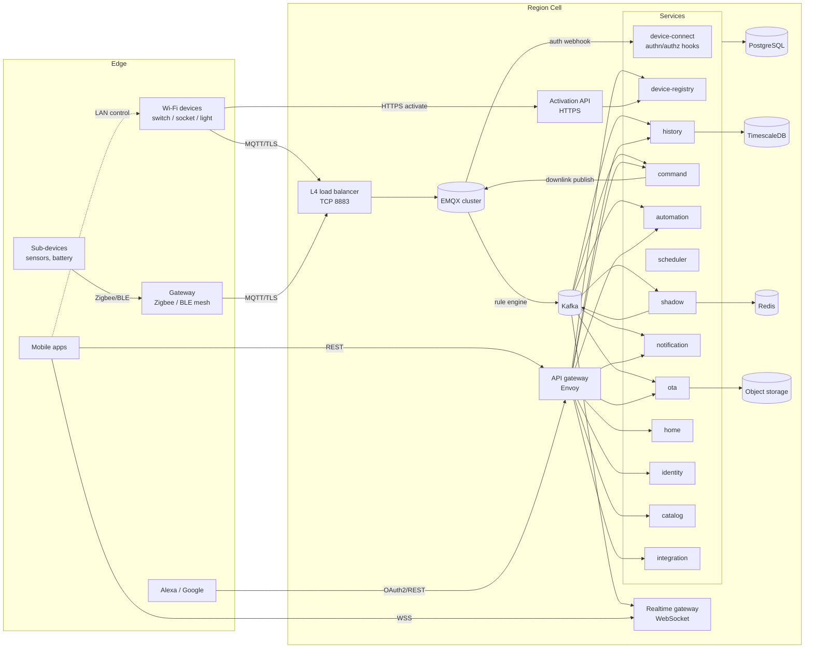
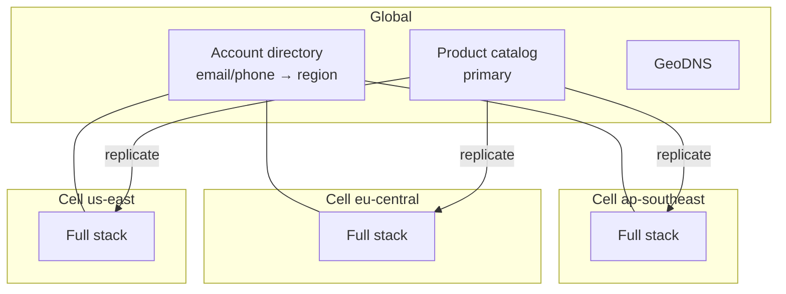

# 01 · System Overview

## 1. Scope

Nestap connects smart home devices to the cloud and to the people who use them. This document set covers the **cloud side only**: architecture, data stores, the MQTT device protocol and backend services. Mobile app UI and device firmware internals are out of scope. Their contracts with the cloud (REST/WebSocket for apps, MQTT/HTTPS for devices) are defined here.

### Functional scope

| Area | Capabilities |
|------|--------------|
| Accounts | Sign up / sign in with email, phone OTP, Google, Apple; sessions; account deletion |
| Homes | Homes, rooms, members with roles, invitations, per-device sharing |
| Products | Product catalog, categories, **thing model** (data points), app panel config, OEM vendors |
| Devices | Factory licenses, pairing (Wi-Fi AP/BLE/EZ), activation, binding, unbinding, Zigbee/BLE sub-devices behind gateways |
| Control | Cloud control over MQTT, LAN control fallback, device shadow, offline handling |
| Automation | Tap-to-run scenes, if-this-then-that automations, timers, countdowns, sunrise/sunset, local (gateway) execution |
| History | DP history, energy metering for sockets/switches, connectivity log, command log |
| OTA | Firmware registry, signed images, staged rollouts, progress tracking |
| Notifications | Push (FCM/APNs), SMS, email, in-app message center |
| Integrations | Amazon Alexa, Google Home, webhooks, Open API for partners |
| Operations | Admin console backend, support diagnostics, audit log |

### Non-functional targets

| Target | Phase 1 (launch) | Design ceiling per region |
|--------|------------------|---------------------------|
| Connected devices | 100k | 5M |
| Sustained uplink messages | 2k msg/s | 100k msg/s |
| App tap → device actuates (p95, in-region) | < 400 ms | < 400 ms |
| Device state → app UI (p95) | < 500 ms | < 500 ms |
| API availability | 99.9% | 99.95% |
| Data loss on region failure (RPO) | ≤ 5 min | ≤ 1 min |

## 2. Design principles

1. **Thing model driven.** A product's behaviour is data, not code. Every device type is described by its **data points (DPs)**: id, code, type, access mode, range. Validation, the app UI, voice integrations and automations all read the same model. Adding a product never needs a backend deploy.
2. **The shadow holds state.** Each device has a *shadow* with `reported` and `desired` state and a version. Apps read the shadow, never the device directly.
3. **Event-driven core.** All device traffic goes broker → Kafka. Services consume events. They don't call each other on the hot path. One uplink message can feed history, automations, realtime fan-out and notifications on its own.
4. **Stateless compute, explicit state.** Services are stateless containers. State lives in PostgreSQL (truth), Redis (hot cache/presence), TimescaleDB (history) and S3 (blobs).
5. **Cells per region.** Each region is a self-contained *cell* for data residency and blast-radius control. Only the account directory and product catalog are global.
6. **Zero trust for devices.** Every device has a unique identity. It can publish and subscribe only to its own topics. Every secret is encrypted at rest.
7. **Each service owns its data.** One PostgreSQL cluster in Phase 1, but one schema per service. Cross-schema joins and foreign keys are not allowed, so services can split out later.

## 3. High-level architecture

### Layers

| Layer | Components | Responsibility |
|-------|------------|----------------|
| **Edge** | Wi-Fi devices, gateways, sub-devices, apps, voice assistants | Produce telemetry and consume commands |
| **Connectivity** | L4 load balancer, EMQX cluster, Activation API, API gateway, Realtime gateway | Terminate TLS, authenticate, rate-limit, route |
| **Event backbone** | Kafka | Durable, ordered (per device) event log between connectivity and services |
| **Domain services** | 14 services (see [04-backend-services.md](04-backend-services.md)) | Business logic |
| **Data** | PostgreSQL, TimescaleDB, Redis, S3 | Persistence (see [03-database.md](03-database.md)) |
| **Platform** | Kubernetes, Vault/KMS, Prometheus, Loki, Tempo, Grafana | Runtime, secrets, observability |

## 4. Technology choices

| Concern | Choice | Why |
|---------|--------|-----|
| MQTT broker | **EMQX 5.x** (open-source edition to start) | Clustered, millions of connections per cluster, MQTT 5, HTTP auth hooks, built-in rule engine with a Kafka sink |
| Backend language | **Go** | High concurrency with little memory; one static binary per service; good MQTT, Kafka and Postgres libraries (`paho.golang`, `franz-go`, `pgx`) |
| Internal RPC | **gRPC** + protobuf | Typed contracts, deadlines and streaming for synchronous calls between services |
| Public API | **REST/JSON** (OpenAPI 3.1) + **WebSocket** for realtime | Easy for mobile and partners |
| Event bus | **Kafka** (or wire-compatible Redpanda) | Partitioning by device ID keeps ordering; replay; many independent consumers |
| Relational DB | **PostgreSQL 16** | Transactions, JSONB for thing-model specs and rule definitions, mature HA (Patroni or a managed service) |
| Time-series | **TimescaleDB** (a separate PostgreSQL cluster) | SQL plus hypertables, compression, retention and continuous aggregates for energy |
| Cache / presence | **Redis 7** (cluster mode) | Shadow hot copy, online presence, pairing tokens, rate limits, realtime pub/sub |
| Blob storage | **S3-compatible** (AWS S3 / MinIO) | Firmware images, icons, exports |
| API gateway | **Envoy** (or Kong) | JWT validation, rate limits, routing, mTLS to services |
| Secrets | **HashiCorp Vault** transit engine or cloud KMS | Envelope encryption for device secrets and OAuth tokens |
| Orchestration | **Kubernetes** + Helm | Standard; EMQX operator available |
| Observability | OpenTelemetry → Prometheus, Tempo, Loki, Grafana | Metrics, traces and logs in one place; trace IDs carried through Kafka headers |

## 5. Regions and cells

- A **user** lives in one region, chosen at sign-up from their country. The global directory maps the login identifier to a region. The app is then pinned to `api.{region}.nestap.io`.
- A **device** lives in its owner's region. The pairing token carries a region code, so the device knows which activation endpoint to call. The activation response gives the regional MQTT host.
- The **product catalog** is written in one place (the vendor console) and replicated read-only to each cell.
- Phase 1 runs **one cell** (the region nearest the launch market). The cell boundary is in the design from day one, so adding regions needs no redesign.

## 6. Scaling model

| Component | How it scales | Sizing rule of thumb |
|-----------|---------------|----------------------|
| EMQX | Add nodes (core + replicant roles) | ~1M connections/node at 1 msg/min per device on 16 vCPU / 32 GB |
| Kafka | Partitions keyed by `device_id` | 48 partitions for `device.uplink` at launch; raise when consumer lag grows |
| Stateless services | Kubernetes HPA on CPU and Kafka lag | Consumers ≤ partitions |
| Redis | Cluster shards | Shadow ≈ 1–2 KB per device → 5M devices ≈ 10 GB |
| PostgreSQL | Vertical first, then read replicas; split per-service clusters when one schema dominates | `device` and `automation` schemas are the first to split out |
| TimescaleDB | Compression (~10×), retention, then multi-node or per-tenant partitioning | 5M devices × 50 DP changes/day ≈ 250M rows/day before compression |

**Hot-path budget (app tap → device):** API gateway 10 ms → command service 20 ms (authz + thing-model check from cache) → EMQX publish 5 ms → network RTT to device 50–200 ms. No database writes on the synchronous path. The command log is written asynchronously from Kafka.

## 7. Reliability

- **Delivery semantics:** uplink is at-least-once (MQTT QoS 1 → Kafka with `acks=all`). Every consumer is idempotent, keyed by `(device_id, msg_id)` or shadow version.
- **Ordering:** per-device ordering is guaranteed by the Kafka partition key. The shadow drops reports with a lower device `seq` (guards against reordering after device reboot or reconnect).
- **Outbox pattern:** a service that changes PostgreSQL and emits an event writes both in one transaction (an `outbox` table). A relay publishes outbox rows to Kafka. No dual-write gaps.
- **Broker loss:** devices reconnect with jittered exponential backoff (1 s → 5 min cap) to the cluster DNS name. On reconnect they send `sys/hello` and resync the shadow.
- **Backpressure:** EMQX per-client rate limits. Kafka absorbs bursts (for example, a mass reconnect after a power cut). Consumers scale on lag.
- **HA:** 3+ EMQX nodes across 3 AZs; Kafka RF=3, `min.insync.replicas=2`; PostgreSQL primary + sync replica + async replica; Redis cluster with replicas. Backups: PITR with 7-day WAL, daily snapshots kept 30 days.

## 8. Security architecture

| Boundary | Control |
|----------|---------|
| Device ↔ cloud | TLS 1.2+ (server cert pinned in firmware via CA bundle); per-device `deviceSecret`; HMAC-signed MQTT password; optional X.509 client certs for premium hardware |
| Device topic access | EMQX authz: a client may only publish `nt/v1/{own id}/up/#` and subscribe `nt/v1/{own id}/down/#` |
| Factory identity | Each module is flashed with `uuid` + `authKey` (license). The license is single-activation per binding, and licenses can be revoked by batch |
| App ↔ cloud | OAuth2-style tokens: 15 min JWT access token (ES256) + rotating refresh token (30 days, reuse detection) |
| Authorization | Checked per request in the service: home role (owner/admin/member) or device share. Never trust IDs sent by the client |
| Secrets at rest | `deviceSecret`, `localKey`, `authKey` and OAuth tokens encrypted with envelope encryption (Vault/KMS data keys, AES-256-GCM) |
| Firmware | Images signed with Ed25519 (offline key); devices verify signature + SHA-256 before flashing |
| Service ↔ service | mTLS in the mesh; network policies deny by default |
| Abuse | Rate limits per IP, user and device; OTP throttling; pairing token TTL of 10 min |
| Privacy | Region data residency; account deletion cascades through services via `user.deleted` events; history is keyed by device ID, which is reissued on every re-pair, so a new owner never sees an old owner's history |

## 9. Observability

- **Metrics:** EMQX (connections, msg rates, auth failures), Kafka consumer lag per group, service RED metrics, command success rate, OTA failure rate.
- **Tracing:** a W3C `traceparent` is created at the API gateway, carried in Kafka headers and in the MQTT 5 user property `tp` on downlinks. Device acks echo the command `id`, so one command can be traced end-to-end.
- **Device diagnostics:** per-device connectivity timeline, last 100 messages (Redis ring buffer, only while support mode is on), RSSI and firmware from `sys/hello`.
- **SLO alerts:** command success < 99% over 5 min, uplink → shadow latency p95 > 1 s, consumer lag > 30 s.

## 10. Deployment phases

| Phase | Deployables | When |
|-------|-------------|------|
| **1 — Modular monolith** | `nestap-api` (identity, home, catalog, device-registry, command, automation APIs as modules), `nestap-connect` (EMQX hooks + activation), `nestap-workers` (shadow, history, automation engine, scheduler, notification, ota), `nestap-realtime` | Launch, < 200k devices |
| **2 — Split hot paths** | Shadow, command and automation engine become their own deployments with their own scaling | Consumer lag or deploy coupling becomes a problem |
| **3 — Per-service databases, multi-region** | `device` and `automation` schemas move to their own clusters; second cell | > 1M devices or a data-residency need |

Module boundaries in Phase 1 follow the service boundaries in [04-backend-services.md](04-backend-services.md) exactly: separate Go packages, separate DB schemas, communication through interfaces and Kafka. That way Phase 2 is a deployment change, not a rewrite.
