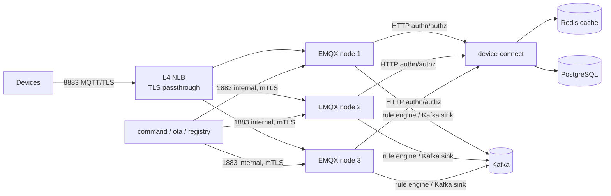
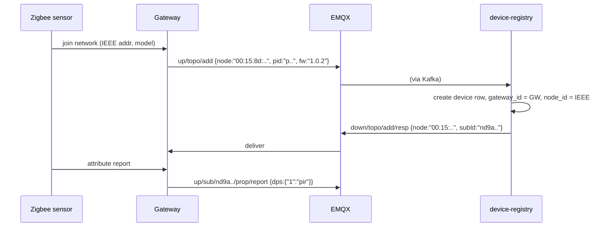

# 02 · MQTT Protocol and Broker Design

This is the contract between Nestap firmware and the cloud. Protocol version: **`v1`**.

## 1. Who talks MQTT

| Client | Talks MQTT? | Notes |
|--------|-------------|-------|
| Wi-Fi devices (switch, socket, light, curtain) | **Yes**, directly | One MQTT connection per device |
| Gateways (Zigbee / BLE mesh) | **Yes**, directly | Proxies its sub-devices over its own connection |
| Sub-devices (Zigbee/BLE sensors) | No | Reach the cloud through the gateway (`sub/` topics) |
| Mobile apps | **No** | Use REST + the WebSocket realtime gateway. The broker stays device-only, so its ACL model stays simple and user auth logic stays out of EMQX |
| Backend services | Downlink only | The `command`, `ota` and `device-registry` services publish through a privileged internal listener. Uplink reaches services via Kafka, never by direct subscription |

## 2. Broker topology (EMQX 5)



| Listener | Port | Who | Auth |
|----------|------|-----|------|
| `ssl:default` | 8883 | Devices (public, through the NLB) | TLS server auth + HMAC username/password (or client cert) |
| `tcp:internal` | 1883, bound to the cluster network only | Backend services | mTLS + a superuser account per service, outside the device ACL |
| Dashboard / REST API | 18083 | Ops only (VPN) | SSO |

- Hostname given to devices: `mqtt.{region}.nestap.io` (returned at activation, never hard-coded except as a fallback).
- TLS: 1.2 minimum, ECDHE-ECDSA-AES128-GCM-SHA256 preferred (cheap on ESP32/BK72xx). Firmware ships a small CA bundle (Nestap root + one backup root).
- Protocol: **MQTT 5.0 preferred**, 3.1.1 accepted (some low-end SDKs only support 3.1.1; expiry is then enforced through the `exp` field in the payload).
- `max_packet_size` = 32 KB; `max_inflight` = 16; `max_mqueue_len` = 32 (devices use clean start, so the queue is only for in-flight bursts).

## 3. Device identity and authentication

Each device has three secrets over its lifetime:

| Secret | Where it comes from | Used for |
|--------|---------------------|----------|
| `uuid` + `authKey` | Flashed at the factory (a *license*) | Proving genuine hardware during activation only |
| `deviceId` + `deviceSecret` | Issued by the cloud at activation | MQTT login |
| `localKey` | Issued by the cloud at activation | LAN control encryption (app ↔ device on the same network) |

A new `deviceId`, `deviceSecret` and `localKey` are issued **on every activation** (every re-pair). An unbound device keeps no working credentials.

### CONNECT fields

| Field | Value |
|-------|-------|
| Client ID | `{deviceId}` (exactly; anything else is rejected) |
| Username | `{deviceId}\|hmacsha256\|{ts}`, where `ts` is Unix seconds |
| Password | `hex( HMAC-SHA256( key = deviceSecret, msg = "clientId={deviceId}&ts={ts}" ) )` |
| Keep alive | 60 s (gateways: 30 s) |
| Clean start | `true`; session expiry `0` |
| Will (optional) | Not used for presence. Presence comes from broker events (§8) |

- `device-connect` accepts `ts` within ±15 min of server time. Devices without an RTC get the time from the activation response or from `GET https://a.{region}.nestap.io/v1/time` before connecting.
- Result caching: `device-connect` caches the decrypted secret in process memory (LRU, 5 min). Revocation is pushed via a Redis pub/sub `dev:revoked` message plus a broker kick (`DELETE /api/v5/clients/{id}`).
- **Optional mTLS mode:** products marked `auth_mode = x509` use per-device certs (CN = deviceId) signed by the Nestap device CA. EMQX checks the cert, and `peer_cert_as_clientid` enforces the client ID.

### Auth failure handling

- 5 failed CONNECTs per minute from one client ID → block that client ID for 10 min (EMQX flapping detection).
- Unknown or unbound `deviceId` → CONNACK `0x86 Bad username or password`. Firmware then falls back to "unbound" mode (LED blink, waits for re-pairing).

## 4. Topic tree

All topics start with `nt/v1/{deviceId}/`. **Direction is in the path** (`up` = device → cloud, `down` = cloud → device), so the ACL is just two rules.

```
nt/v1/{deviceId}/
├── up/                                  device → cloud
│   ├── sys/hello                        on every connect: fw, ip, rssi, capabilities
│   ├── sys/time/req                     NTP-style time sync request
│   ├── sys/log                          diagnostics (only when enabled by cloud)
│   ├── prop/report                      DP state report (changes or full snapshot)
│   ├── prop/set/ack                     acknowledgement of a down/prop/set
│   ├── event/{code}                     discrete events: fault, overload, button, alarm
│   ├── rpc/resp                         reply to down/rpc/req
│   ├── shadow/get                       ask for desired state + version (after reconnect)
│   ├── ota/progress                     OTA stage and percent
│   ├── rule/ack                         gateway: local rule set applied
│   ├── topo/{add|remove|list}           gateway: sub-device topology changes
│   └── sub/{subId}/{prop/report|prop/set/ack|event/{code}|ota/progress|online|offline}
│                                        gateway on behalf of a sub-device
└── down/                                cloud → device
    ├── sys/time/resp
    ├── sys/config                       timezone, report intervals, log level, feature flags
    ├── prop/set                         command: set DPs
    ├── prop/get                         ask the device to report all/some DPs now
    ├── rpc/req                          reboot, factory_reset, unbind, diag, etc.
    ├── shadow/sync                      desired state delta + version
    ├── ota/upgrade                      OTA job offer
    ├── rule/sync                        gateway: local automation rules
    ├── topo/{add|remove|list}/resp      gateway: replies
    └── sub/{subId}/{prop/set|prop/get|rpc/req|ota/upgrade}
```

`{subId}` is the cloud device ID of the sub-device (not its Zigbee/BLE address). The gateway keeps the mapping it received in `topo/add/resp`.

### QoS and retain per topic

| Topic | QoS | Retain | Notes |
|-------|-----|--------|-------|
| `up/prop/report` | 1 | no | Telemetry-only DPs (for example `cur_power`) may use QoS 0, set per DP in the thing model |
| `up/prop/set/ack`, `up/rpc/resp`, `up/event/*` | 1 | no | |
| `up/sys/hello`, `up/ota/progress` | 1 | no | |
| `up/sys/log` | 0 | no | Best effort |
| `down/prop/set`, `down/rpc/req` | 1 | **no** | MQTT 5 *Message Expiry* = 30 s. Never retained, so a stale "turn on" can't arrive later |
| `down/shadow/sync`, `down/sys/config`, `down/ota/upgrade`, `down/rule/sync` | 1 | no | Re-sent by the cloud on `sys/hello` |

**No retained messages anywhere.** State recovery after a reconnect is explicit: the device sends `sys/hello`, and the cloud answers with `sys/config`, `shadow/sync` and any pending `ota/upgrade`.

## 5. Payload format

UTF-8 JSON, compact keys, one envelope for every topic:

```jsonc
{
  "id":  "01JC7Q8Z1K",          // message id: device-generated for up, cloud-generated for down (ULID/base32, ≤ 26 chars)
  "ts":  1762480000123,         // sender's Unix ms
  "seq": 1842,                  // up only: monotonic per boot+session, used to drop reordered reports
  "data": { ... }               // topic-specific body
}
```

Down messages may also carry `"exp": <unix ms>`. A device on MQTT 3.1.1 must drop a command whose `exp` is in the past.

DPs are keyed by **numeric DP id as a string** on the wire (`"1"`, `"9"`). It's compact, and firmware never needs DP names. The cloud maps id ↔ code using the product's thing model. Constrained devices may negotiate CBOR in `sys/hello` (`"enc":"cbor"`); the envelope keys stay the same.

### 5.1 `up/sys/hello`

```jsonc
{ "id":"h1","ts":1762480000123,"data":{
    "pid":"p7rk2m9q4x8t1c3n", "fw":{"main":"1.4.2","mcu":"1.0.7"},
    "proto":"v1", "enc":"json",
    "net":{"ip":"192.168.1.42","rssi":-58,"bssid_hash":"9f2c..","ch":6},
    "boot":"power_on", "caps":["lan","ota","timer_local"]
}}
```

Cloud reaction: update presence metadata and firmware version, then send `down/sys/config`, `down/shadow/sync`, and any pending OTA job.

### 5.2 `up/prop/report`

```jsonc
{ "id":"r9","ts":1762480001200,"seq":1843,"data":{
    "dps":{"1":true,"2":false,"19":1250,"20":2301},
    "full":false,
    "src":"local"             // local = physical button/local timer, cloud = result of a cloud command, auto = local rule
}}
```

- Report **only changed DPs**, except right after `sys/hello` and on `down/prop/get`, when `full:true` with every readable DP.
- Each DP's `report_policy.min_interval_s` in the thing model caps how often metering DPs are sent (for example `cur_power` at most every 10 s, or on a ≥5% change).

### 5.3 `down/prop/set` and `up/prop/set/ack`

```jsonc
// down
{ "id":"c_01JC7QA3P0","ts":1762480002000,"exp":1762480032000,"data":{"dps":{"1":false}}}
// up ack (same id)
{ "id":"c_01JC7QA3P0","ts":1762480002090,"data":{"code":0}}
```

The ack only says "received and applied". The new state always arrives separately in `prop/report`, which is what the shadow and app trust. Ack `code` values:

| code | Meaning |
|------|---------|
| 0 | OK |
| 1 | Unknown DP |
| 2 | Value out of range / wrong type |
| 3 | DP is read-only |
| 4 | Busy (for example, mid-OTA) |
| 5 | Expired (`exp` passed) |
| 6 | MCU did not respond (two-chip designs) |

### 5.4 `down/rpc/req` and `up/rpc/resp`

```jsonc
{ "id":"rpc_01J..","ts":...,"exp":...,"data":{"method":"reboot","params":{}}}
{ "id":"rpc_01J..","ts":...,"data":{"code":0,"result":{}}}
```

Standard methods: `reboot`, `factory_reset`, `unbind` (wipe credentials, return to pairing mode), `get_diag` (heap, uptime, reconnect count), `set_log` (`{"level":"debug","minutes":30}`), `get_timers` / `set_timers` (on-device timers for `timer_local` devices), `ota_start` (`{"job":"…"}`, starts an OTA job offered in `notify` mode once the user confirms), `group_set` (gateways: `{"group_no":3,"dps":{...}}` sent as one Zigbee/BLE-mesh group frame).

### 5.5 `up/event/{code}`

```jsonc
// nt/v1/{id}/up/event/overload
{ "id":"e3","ts":...,"data":{"dp":"1","value":16.4,"unit":"A","action":"tripped"}}
```

Event codes are declared per product in the thing model (category `event`). They feed automations ("when the scene button is double-pressed") and notifications (alarms).

### 5.6 Shadow sync

```jsonc
// up/shadow/get
{ "id":"s1","ts":...,"data":{"ver":118}}
// down/shadow/sync  (desired delta newer than device's version)
{ "id":"s1","ts":...,"data":{"ver":121,"desired":{"7":3600,"101":"warm"}}}
```

The shadow's `desired` side only holds DPs marked `offline_queue: true` in the thing model (config values such as power-on behaviour or LED mode). **Actuating DPs (on/off, open/close) are never queued**, so a device coming back online never switches a load unexpectedly.

### 5.7 OTA

```jsonc
// down/ota/upgrade
{ "id":"ota_01J..","ts":...,"data":{
  "job":"9b1e..","module":"main","ver":"1.5.0","vc":10500,
  "url":"https://fw.{region}.nestap.io/f/9b1e...?sig=...&exp=...",
  "size":917504,"sha256":"5f0c...","sig":"ed25519:3a9d...","mode":"notify"}}
// up/ota/progress
{ "id":"op7","ts":...,"data":{"job":"9b1e..","stage":"downloading","pct":42}}
```

`stage`: `accepted` → `downloading` → `verifying` → `flashing` → `rebooting` → `succeeded` | `failed` (with `err`: `download`, `checksum`, `signature`, `flash`, `low_power`, `rejected`). Success is confirmed by the next `sys/hello` with the new version.

### 5.8 Time sync

```jsonc
// up/sys/time/req
{ "id":"t1","ts":1762480000000,"data":{}}
// down/sys/time/resp
{ "id":"t1","ts":1762480000045,"data":{"dev_ts":1762480000000,"rx":1762480000031,"tx":1762480000040,"tz":"Asia/Dhaka","tz_offset_s":21600}}
```

## 6. Gateways and sub-devices



- `topo/add` is accepted only while the gateway's home has an active pairing session (an app "add sub-device" flow). Otherwise the cloud replies with `code: 7 not_permitted`.
- Sub-device online/offline is reported by the gateway (`up/sub/{subId}/online|offline`) based on Zigbee/BLE reachability. If the gateway itself goes offline, every sub-device is shown offline.
- ACL needs no extra rule: the gateway still only publishes under `nt/v1/{gatewayId}/up/#`. Ingest checks that `{subId}` really belongs to that gateway (`devices.gateway_id`).

## 7. Access control (EMQX authorization)

Evaluated by `device-connect` (HTTP authz) and cached by EMQX per client (`cache.max_size = 64`, TTL 1 min):

| Client | Action | Allowed topic filter |
|--------|--------|----------------------|
| Device `{id}` | publish | `nt/v1/{id}/up/#` |
| Device `{id}` | subscribe | `nt/v1/{id}/down/#` |
| Internal service (internal listener) | publish | `nt/v1/+/down/#` |
| Anyone | anything else | **deny** (includes `#`, `$SYS/#`, other devices' topics) |

Equivalent static file ACL (usable in EMQX as a first, fast check before the HTTP hook):

```erlang
{allow, all, publish,   ["nt/v1/${clientid}/up/#"]}.
{allow, all, subscribe, ["nt/v1/${clientid}/down/#"]}.
{allow, {username, {re, "^svc-"}}, publish, ["nt/v1/+/down/#"]}.
{deny,  all}.
```

## 8. Presence (online / offline)

The broker's client lifecycle events are the source of truth. LWT is not used.

```sql
-- EMQX rule: lifecycle → Kafka topic device.lifecycle (key = clientid)
SELECT clientid AS device_id, event, timestamp, peername, node, reason
FROM "$events/client_connected", "$events/client_disconnected"
```

The `shadow` service consumes `device.lifecycle`:

- **connected** → `SET dev:online:{id} {node, ip, since}`, publish `device.presence.changed {online:true}`.
- **disconnected** → wait a **30 s grace period** (cancelled if a connect arrives) before marking offline. This avoids "offline" notifications during a quick Wi-Fi blip or broker failover.
- Stale guard: events carry the broker timestamp, so an older `disconnected` never overwrites a newer `connected`.
- `last_online_at` is written to PostgreSQL in batches (once a minute), not on every event.

## 9. Uplink into Kafka

```sql
-- EMQX rule: all device uplink → Kafka topic device.uplink (key = clientid)
SELECT clientid AS device_id, topic, payload, timestamp AS broker_ts, node
FROM "nt/v1/+/up/#"
```

Kafka message headers: `device_id`, `topic_suffix` (for example `prop/report`), `broker_ts`, `proto=v1`. The `shadow`, `command`, `ota`, `device-registry` (topo) and `history` services each consume `device.uplink` in their own consumer group and ignore suffixes they don't handle.

## 10. Downlink from services

- Services publish through a **pooled internal MQTT client** (library `pkg/mqttproto`): 4–8 persistent connections per pod to the internal listener, QoS 1, MQTT 5 with message expiry and the user property `tp` (trace parent).
- Before publishing, the publisher checks `dev:online:{id}`. If the device is offline it returns `DEVICE_OFFLINE` at once, without publishing.
- Delivery confirmation is the device's `ack`/`resp`, correlated through `id` in Redis (`cmd:{id}`, TTL 60 s). The PUBACK only proves delivery to the broker.

## 11. Rate limits and quotas

| Limit | Value | Action when exceeded |
|-------|-------|----------------------|
| Messages in per device | 10/s sustained, burst 30 | EMQX drops; repeat offenders are disconnected and flagged |
| Messages in per gateway | 100/s, burst 300 | Same |
| `prop/report` per DP | Thing-model `min_interval_s` | Shadow service drops excess and counts it in metrics |
| Payload size | 16 KB (device), 32 KB (gateway) | Disconnect (protocol error) |
| Connects per device | 5/min | Flapping ban, 10 min |
| Downlink commands per device | 5/s | API returns `429` |

## 12. LAN control (app ↔ device, no cloud)

Not MQTT, but it shares the same DP model. The app finds devices with a UDP broadcast on port 6667 (`{deviceId, ip, pid, ver}` encrypted with a product-level discovery key). It then opens TCP 6668 to the device, and every frame is AES-128-GCM encrypted with the device's `localKey`. Frames carry the same `{"dps":{...}}` body. The device reports any state change made through LAN to the cloud too (`src:"lan"`), so the shadow stays correct. The app gets `localKey` from `GET /v1/devices/{id}` only for users with control permission.

## 13. Versioning

- The topic prefix carries the major version (`nt/v1`). A breaking change gets `nt/v2`, and both are served side by side. The ACL rules simply repeat per version.
- Additive changes (new optional fields, new RPC methods, new topics) don't change the version. Firmware must ignore unknown fields and reply `code: 1 unknown` to unknown RPC methods.
