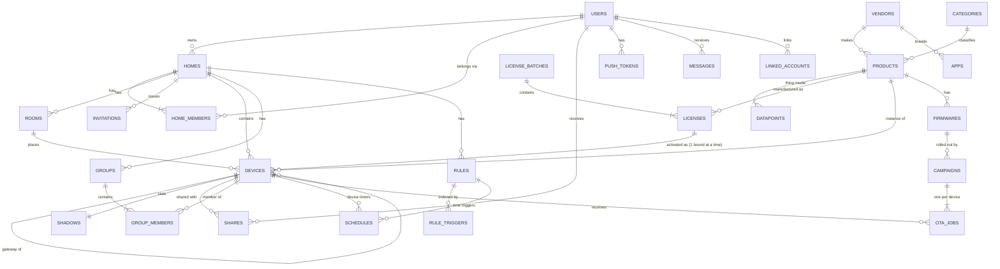

# 03 · Database Design

DDL: [`db/postgres/001_core_schema.sql`](../../db/postgres/001_core_schema.sql) and [`db/timescale/001_telemetry_schema.sql`](../../db/timescale/001_telemetry_schema.sql).

## 1. Stores and what goes where

| Store | Holds | Why this store | Written by |
|-------|-------|----------------|------------|
| **PostgreSQL 16** (core) | Users, homes, products/thing models, devices, licenses, shadows (durable copy), rules, schedules, OTA, notifications config | Transactions, constraints, JSONB for flexible specs | Owning service only |
| **TimescaleDB** (telemetry) | DP history, energy, events, connectivity, command log, automation runs, audit | High-volume append-only time series; compression and retention built in | `history` service only (from Kafka) |
| **Redis 7 cluster** | Shadow hot copy, presence, auth cache, pairing tokens, pending commands, rate limits, realtime pub/sub | Sub-millisecond reads on the hot path; TTLs | `shadow`, `device-connect`, `command`, `realtime`, `identity` |
| **Kafka** | Event log between services (7-day retention) | Ordering per device, replay, fan-out | EMQX rule engine, outbox relay, services |
| **S3-compatible** | Firmware images, product icons, user avatars, data exports | Cheap blobs, signed URLs, CDN | `ota`, `catalog`, `identity` |

**Rule:** PostgreSQL is the source of truth. Redis can be lost and rebuilt (shadow from `device.shadows`; presence from broker reconnects). TimescaleDB can be rebuilt from Kafka for the last 7 days.

## 2. Schema ownership

| Schema | Owner service | Tables |
|--------|---------------|--------|
| `identity` | identity | `users`, `external_identities`, `oauth_clients`, `sessions` |
| `catalog` | catalog | `vendors`, `apps`, `categories`, `products`, `datapoints` |
| `home` | home | `homes`, `rooms`, `members`, `invitations` |
| `device` | device-registry (+ shadow for `shadows`) | `license_batches`, `licenses`, `devices`, `shadows`, `shares`, `groups`, `group_members` |
| `automation` | automation (+ scheduler for `schedules`) | `rules`, `rule_triggers`, `schedules` |
| `ota` | ota | `firmwares`, `campaigns`, `jobs` |
| `notify` | notification | `push_tokens`, `messages`, `preferences` |
| `integration` | integration | `linked_accounts`, `webhooks` |
| `infra` | shared | `outbox`, helper functions |

- **No foreign keys across schemas.** A cross-schema reference such as `device.devices.home_id → home.homes` is kept consistent by events. For example, `home.deleted` makes device-registry unbind that home's devices. This is what lets a schema move to its own cluster in Phase 3.
- Each service connects with its own DB role, which has `USAGE` only on its own schema(s) and `infra`.

## 3. Entity relationships



## 4. Key modelling decisions

### 4.1 Thing model (`catalog.datapoints`)

A product is a list of **data points**. Every DP has:

| Field | Example | Purpose |
|-------|---------|---------|
| `dp_id` | `1` | Wire id used in MQTT (compact, firmware-friendly) |
| `code` | `switch_1` | Stable name used by APIs, automations, voice, history |
| `type` | `bool` / `value` / `enum` / `string` / `bitmap` / `raw` / `json` | Validation and storage column |
| `mode` | `rw` / `ro` / `wo` | `ro` can't be commanded; `wo` isn't in the shadow |
| `spec` | `{"min":0,"max":86400,"step":1,"scale":0,"unit":"s"}` | Range checks. `scale` = decimal places: the wire integer `2301` with scale 1 = `230.1` |
| `report_policy` | `{"min_interval_s":10,"history":"change","offline_queue":false,"energy":"power_w"}` | Ingest throttling, history, shadow-desired eligibility, energy normalisation |

Example: a 2-gang smart switch with metering.

| dp_id | code | type | mode | spec |
|------:|------|------|------|------|
| 1 | `switch_1` | bool | rw | – |
| 2 | `switch_2` | bool | rw | – |
| 7 | `countdown_1` | value | rw | 0–86400 s |
| 8 | `countdown_2` | value | rw | 0–86400 s |
| 14 | `relay_status` | enum | rw | `power_off`, `power_on`, `last` (`offline_queue: true`) |
| 15 | `light_mode` | enum | rw | `none`, `relay`, `pos` (`offline_queue: true`) |
| 17 | `add_ele` | value | ro | Wh delta since last report, `energy: energy_wh_delta` |
| 18 | `cur_current` | value | ro | mA, scale 0, `energy: current_ma` |
| 19 | `cur_power` | value | ro | W, scale 1, `energy: power_w`, `min_interval_s: 10` |
| 20 | `cur_voltage` | value | ro | V, scale 1, `energy: voltage_v` |
| 29 | `fault` | bitmap | ro | `overcurrent`, `overvoltage`, `overheat` |

Thing models are cached in every service's memory, keyed by `(product_id, thing_model_version)`. They're refreshed on `catalog.product.updated`. A device row stores the `thing_model_ver` it was activated with, so a firmware that is behind keeps working until it's upgraded.

### 4.2 Device identity: licenses vs. devices

- `device.licenses` = **physical hardware** (factory `uuid` + `authKey`). It lives forever.
- `device.devices` = **one activation** of that hardware by one owner. Re-pair → new row, new `id`, new `deviceSecret`/`localKey`. The old row → `status = 'unbound'`, its secrets nulled.
- Partial unique index `devices_license_bound_idx` guarantees a piece of hardware is bound to only one home at a time.
- Sub-devices have no license. They're identified by `(gateway_id, node_id)`, unique while bound.

### 4.3 Shadow: Redis hot, PostgreSQL durable

| | Redis `dev:shadow:{id}` | PostgreSQL `device.shadows` |
|-|--------------------------|-----------------------------|
| Read by | Apps (via API), automation engine, voice | Recovery, cold reads on a cache miss |
| Written | On every accepted report (Lua script: compare `seq`, merge, bump version, atomically) | Write-behind batch: at most once per 5 s per device, on a 1 s flush tick |
| Loss tolerance | Rebuilt on a miss from PostgreSQL, then refreshed by the device's next full report after `sys/hello` | Up to 5 s of changes, recovered from the next device report |

Shadow values are stored **by code with scale applied** (`{"cur_power": 125.0}`) so readers never need the thing model to interpret them.

### 4.4 Permissions model

Effective permission for `(user, device)` is resolved in this order:

1. `home.members` row for the device's home with role `owner`/`admin` → full control + manage.
2. `member` role → control, limited to `room_ids` when that is set.
3. `device.shares` row (unexpired) → `view` or `control` for that device only.
4. Otherwise → none (`404` to the client, so device IDs can't be probed).

The command and history services cache the result in Redis `perm:{userId}:{deviceId}` for 60 s. `home.member.*` and `device.share.*` events invalidate it.

### 4.5 Automations: JSON documents + inverted index

Rule conditions and actions are JSON (schema in [04-backend-services.md §Automation](04-backend-services.md#9-automation)). On save, the service rewrites `automation.rule_triggers` for the rule, one row per device/DP the rule listens to. On each `device.state.changed` the engine does **one indexed lookup** on `(device_id, dp_code)` (cached in Redis as `trg:{deviceId}`) instead of scanning rules.

### 4.6 Scheduling without a separate queue

`automation.schedules.next_run_at` + `FOR UPDATE SKIP LOCKED` is the job queue:

```sql
WITH due AS (
  SELECT id FROM automation.schedules
  WHERE enabled AND next_run_at <= now()
    AND (claimed_until IS NULL OR claimed_until < now())
  ORDER BY next_run_at
  LIMIT 500
  FOR UPDATE SKIP LOCKED
)
UPDATE automation.schedules s
SET claimed_until = now() + interval '30 seconds'
FROM due WHERE s.id = due.id
RETURNING s.*;
```

After running a job, the worker computes the next occurrence in the schedule's `timezone` (DST-safe; sun events use home lat/long) and writes `next_run_at`, clearing `claimed_until`. This copes with ~5k jobs/s per PostgreSQL primary. If that's ever not enough, the table partitions by `home_id` hash.

## 5. TimescaleDB layout and retention

| Hypertable | Chunk | Compress after | Keep | Typical query |
|------------|-------|----------------|------|---------------|
| `dp_history` | 1 day | 7 days | 180 days | "Switch 1 log for the last 7 days" |
| `energy_samples` | 1 day | 3 days | 90 days | Live power chart (last 24 h) |
| `energy_hourly` (continuous aggregate) | – | – | 3 years | Day/week/month/year energy in the home's timezone |
| `device_events` | 7 days | – | 365 days | Alarm history |
| `connectivity` | 7 days | – | 90 days | "When was it offline?" (support) |
| `command_log` | 1 day | – | 30 days | Command tracing, support |
| `automation_runs` | 7 days | – | 30 days | Automation log in the app |
| `audit_log` | 30 days | – | 2 years | Security / compliance |

Energy for "this month" in `Asia/Dhaka`:

```sql
SELECT time_bucket(INTERVAL '1 day', bucket, 'Asia/Dhaka') AS day,
       sum(energy_wh) / 1000.0 AS kwh
FROM telemetry.energy_hourly
WHERE device_id = $1
  AND bucket >= date_trunc('month', now() AT TIME ZONE 'Asia/Dhaka') AT TIME ZONE 'Asia/Dhaka'
GROUP BY day ORDER BY day;
```

Writes come from the `history` service in batches (`COPY`, 1,000 rows or 500 ms, whichever comes first) for steady ingest throughput.

## 6. Redis key catalog

| Key | Type | TTL | Owner | Content |
|-----|------|-----|-------|---------|
| `dev:online:{deviceId}` | hash | none (deleted on offline) | shadow | `node`, `ip`, `since`, `fw`, `rssi` |
| `dev:shadow:{deviceId}` | hash | 7 days sliding | shadow | `reported` (JSON), `desired`, `version`, `seq`, `boot` |
| `dev:auth:{deviceId}` | hash | 5 min | device-connect | Encrypted secret + status for MQTT auth |
| `dev:meta:{deviceId}` | hash | 10 min | device-registry | `product_id`, `home_id`, `gateway_id`, `thing_model_ver` |
| `pair:{token}` | hash | 10 min | device-registry | `user_id`, `home_id`, `room_id`, `region` |
| `pair:{token}:devices` | set | 10 min | device-registry | Device IDs activated with this token (app polls) |
| `cmd:{commandId}` | hash | 60 s | command | `device_id`, `actor`, `sent_at`, `status` |
| `perm:{userId}:{deviceId}` | string | 60 s | command/history | `owner`/`admin`/`member`/`control`/`view`/`none` |
| `trg:{deviceId}` | hash | 10 min | automation | `dp_code → [rule_id…]` |
| `rl:{scope}:{id}` | string | window | api-gateway, command | Token bucket counters |
| `otp:{channel}:{target}` | hash | 5 min | identity | OTP hash, attempts |
| `rt:home:{homeId}` | pub/sub channel | – | realtime | State/presence fan-out to WebSocket pods |
| `dev:revoked` | pub/sub channel | – | device-registry | Evict auth caches immediately |

Eviction policy: `volatile-lru`. Keys without a TTL (presence) are never evicted.

## 7. Operational practices

- **Migrations:** `golang-migrate` (or Atlas). One migration directory per schema, applied by the owning service's CI pipeline. Only expand/contract changes (add a column → deploy → backfill → drop old). Never a blocking `ALTER` on `device.devices` without `CONCURRENTLY`/batching.
- **Connection pooling:** PgBouncer in transaction mode in front of the core cluster. Each service pool ≤ 20 connections per pod.
- **Backups:** PITR (WAL archiving to S3, 7 days) + daily base backups kept 30 days. Monthly restore drill.
- **Encryption:** disk-level encryption at rest. Application-level envelope encryption for `*_enc` columns. TLS for all client connections.
- **PII and deletion:** on `user.deleted`, each service removes or anonymises its rows within 30 days. The identity service keeps a tombstone (`status = 'deleted'`, email/phone nulled) so dangling IDs still resolve.
- **Hot table watchlist:** `device.devices` (heavy reads → served from `dev:meta` cache), `device.shadows` (write-behind batching), `automation.schedules` (SKIP LOCKED polling), `infra.outbox` (relay deletes rows older than 3 days that have been published).
