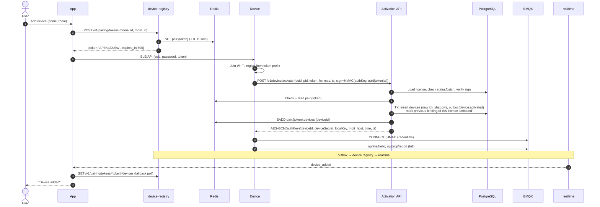
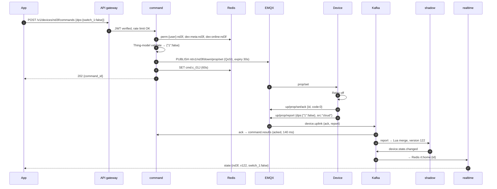
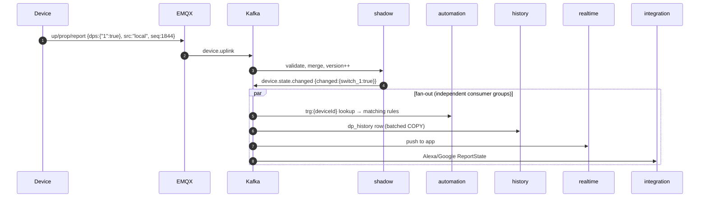
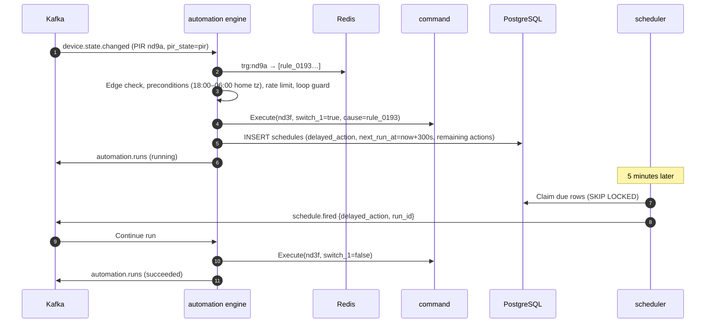
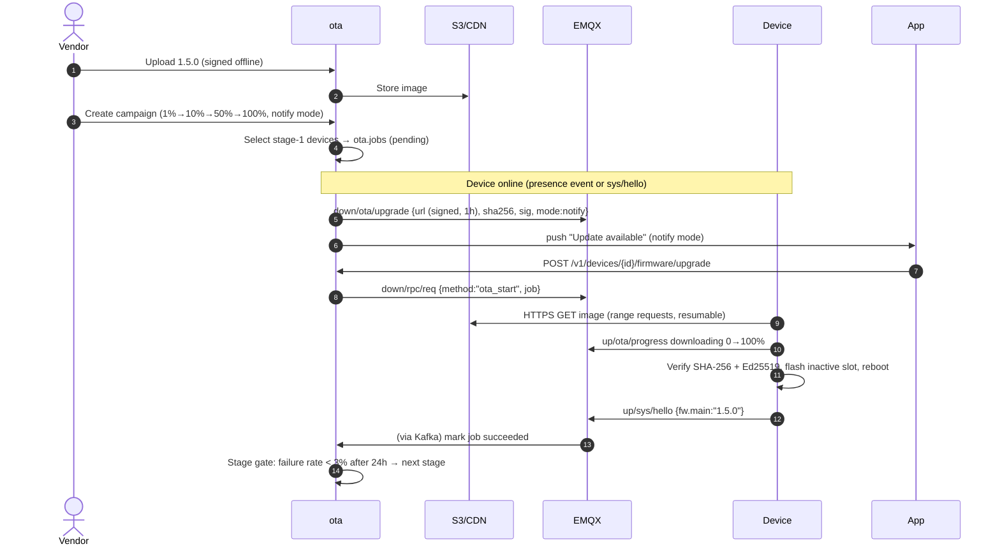
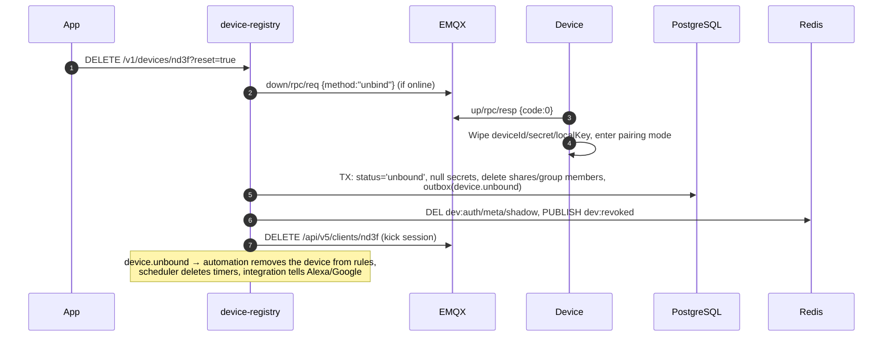
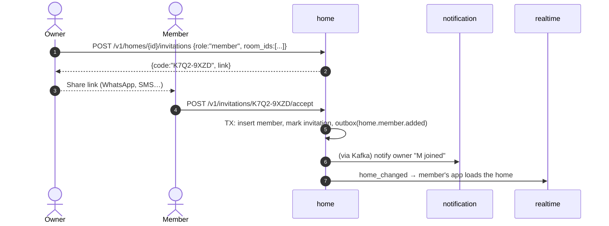

# 05 · Key Flows

## 1. Device pairing and activation

Supported pairing modes (from the app's point of view they differ only in step 3):

| Mode | How Wi-Fi credentials reach the device |
|------|----------------------------------------|
| **BLE** (preferred, `wifi_ble` products) | App writes SSID, password and token to a GATT characteristic, encrypted with an ECDH-derived session key |
| **AP mode** | Device starts a `Nestap-XXXX` SoftAP. The app joins it and POSTs the data to `192.168.4.1` |
| **EZ mode** | Legacy broadcast-length encoding, only for old modules without BLE |

Failure handling:

| Case | Behaviour |
|------|-----------|
| Token expired/unknown | `410` to device. The device returns to pairing mode and the app shows "Timed out, try again" |
| License revoked or signature bad | `403` + audit log + security metric. The device blinks an error pattern |
| License already bound elsewhere | Allowed (the factory-reset button press proves physical access). The old binding is unbound and its owner gets a "device removed" message |
| Activation response lost (device retries) | Same `(uuid, token)` within the token TTL returns the same credentials (idempotent) |

## 2. App controls a device

If no ack arrives within 10 s, command emits `timeout` and the app rolls back its optimistic UI with "Device not responding".

## 3. Physical button press → app, automations, history

## 4. Automation with a delay

"When the hallway PIR detects motion after dark, turn the light on, then off after 5 minutes."

If motion fires again while the delay is pending, the default `restart` mode replaces the pending delayed action, so the light stays on for 5 minutes after the *last* motion. The rule's `run_mode` can be `restart` (default), `single` (ignore new triggers while running) or `parallel`.

## 5. OTA staged rollout

Devices use A/B partitions (or a bootloader with rollback). If the new image fails to connect within 3 boots, the bootloader rolls back and the next `sys/hello` reports the old version → job `failed: rollback`.

## 6. Remove device / factory reset

If the device is offline, the cloud side still unbinds. The device's next CONNECT fails auth, and it falls back to pairing mode.

## 7. Inviting a family member

