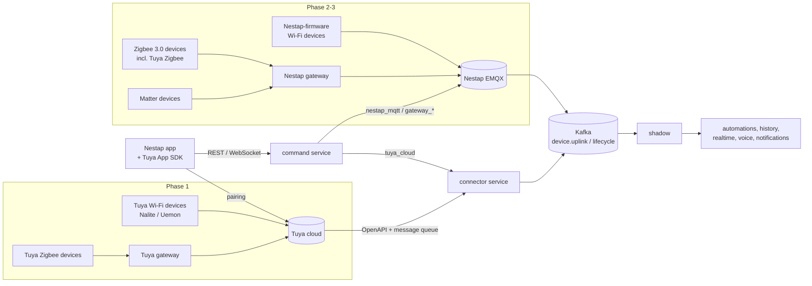
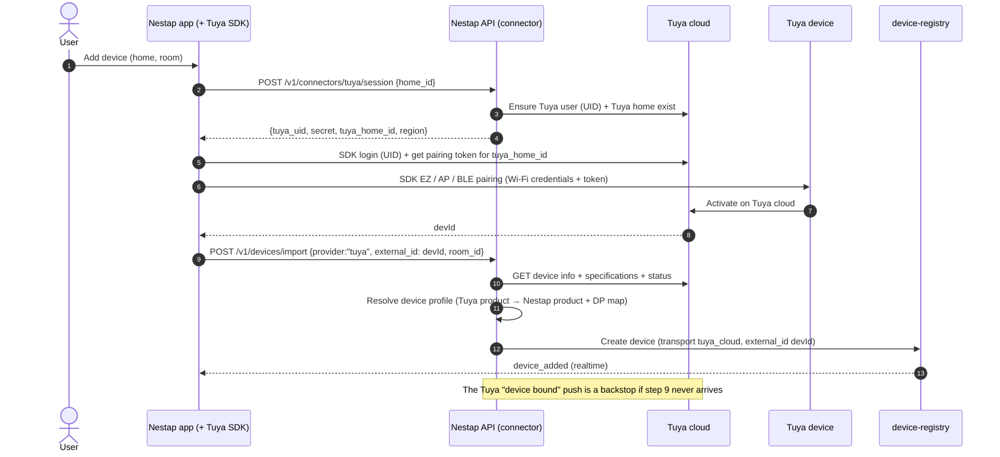

# 06 · Device Compatibility (Market Devices)

## 1. Why this layer exists

Nestap's current hardware suppliers both ship devices on the **Tuya** platform:

| Supplier | Devices | Platform as shipped |
|----------|---------|---------------------|
| Nalite (D6 series confirmed from its selection sheet; check other series the same way) | Wall switches, scene switches, curtain switches, 20A/40A switches, Wi-Fi/BLE Zigbee gateway | Tuya Wi-Fi and Tuya Zigbee |
| Uemon (OEM partner, next phase) | Switches, sockets, curtain modules, sensors, gateways, panels, locks, thermostats | Tuya Wi-Fi and Tuya Zigbee 3.0. OEM branding/packaging offered; no custom firmware or private cloud advertised |

Stock Tuya firmware only connects to Tuya's cloud. These devices **cannot** connect to the Nestap MQTT broker ([02-mqtt-protocol.md](02-mqtt-protocol.md)) unless they're reflashed. The Nestap app must still work with them **from day one**.

This document adds a **transport** concept. A device can reach Nestap in more than one way, and everything above the device shadow (apps, automations, history, energy, notifications, voice) works the same whatever the transport.

## 2. Transports

| Transport | Device runs | Path to Nestap | Phase |
|-----------|-------------|----------------|-------|
| `tuya_cloud` | Stock Tuya firmware (Wi-Fi, or Zigbee behind a Tuya gateway) | Device ↔ Tuya cloud ↔ **Nestap connector** (Tuya OpenAPI + message service) | **1 — now** |
| `nestap_mqtt` | Nestap firmware (factory-flashed through the OEM) | Device ↔ Nestap EMQX directly | 2 — after the OEM agrees to custom firmware |
| `gateway_zigbee` | Stock Zigbee 3.0 firmware (including Tuya Zigbee) | Zigbee ↔ **Nestap gateway** ↔ Nestap EMQX (`sub/` topics) | 2 |
| `gateway_matter` | Matter-certified firmware, any brand | Matter ↔ Nestap gateway (Matter controller) ↔ Nestap EMQX | 3 |

## 3. Phase 1 design: Tuya-backed devices in the Nestap app

### 3.1 What runs where

| Concern | Handled by | Notes |
|---------|-----------|-------|
| Accounts, homes, rooms, members, sharing | **Nestap** | Nestap is the source of truth. Tuya-side users and homes are hidden plumbing, created and kept in sync by the connector |
| Pairing Wi-Fi devices (EZ / AP / BLE) | **Tuya App SDK inside the Nestap app** | Tuya's pairing protocol is proprietary. The SDK is the supported way for a custom app to pair Tuya devices |
| Adding Zigbee sub-devices | Tuya App SDK, through a Tuya gateway | Same flow as Wi-Fi, using the gateway's sub-device pairing |
| Device state and events | Tuya message service → **connector** → Kafka → **shadow** | No polling. Tuya pushes changes |
| Cloud control | Nestap `command` service → **connector** → Tuya OpenAPI | One control path for app, automations, schedules and voice |
| LAN control (optional) | Tuya App SDK in the app | Speed-up when the phone is on the same Wi-Fi. The state change still reaches Nestap through Tuya's push |
| Automations, schedules, energy history, notifications, Alexa/Google | **Nestap** | Tuya's own scenes and automations are not used, so the logic is the same for every transport |
| Firmware updates | Tuya (vendor's Tuya account) | Nestap's OTA service applies only to `nestap_mqtt` devices |

### 3.2 Identity mapping

The user signs in to **Nestap only**. The connector keeps a hidden Tuya identity behind each Nestap identity:

| Nestap | Tuya | How |
|--------|------|-----|
| User | Tuya app user, created with the SDK's user-ID (UID) login | UID = Nestap user ID, password = random secret stored encrypted in `connector.user_links`. The app gets these from `POST /v1/connectors/tuya/session` and signs the SDK in silently |
| Home | Tuya home owned by the Nestap home owner's Tuya user | Created on the first Tuya pairing in that home. Kept in `connector.home_links` |
| Home member | Tuya home member | Synced by the connector, so members' apps can also use SDK LAN control |
| Device | Tuya device ID (`devId`) | `device.devices.external_id`, with `transport = 'tuya_cloud'` |

### 3.3 Pairing flow

### 3.4 State, presence and commands

**Uplink.** The connector consumes Tuya's message service (status reports, online/offline, device added/removed). It translates each message into the **same envelope** the MQTT path uses, then publishes it:

| Tuya message | Nestap Kafka topic | Header `transport` | Body |
|--------------|--------------------|--------------------|------|
| Status report | `device.uplink` (`topic_suffix=prop/report`) | `tuya_cloud` | `{"codes":{"switch_1":true,"cur_power":1250},"src":"tuya"}`: Nestap codes, unscaled values |
| Online / offline | `device.lifecycle` | `tuya_cloud` | `connected` / `disconnected` |
| Device removed in Tuya | `device.uplink` (`topic_suffix=sys/removed`) | `tuya_cloud` | Registry unbinds the Nestap device |

The shadow service accepts either `dps` (wire IDs, from MQTT) or `codes` (from connectors). After that step the pipeline is identical. Ordering is by Kafka key = Nestap device ID, as before.

**Downlink.** The `command` service looks up `devices.transport`:

- `nestap_mqtt` / `gateway_*` → publish to EMQX (unchanged).
- `tuya_cloud` → gRPC `connector.SendCommand(device, codes)` → Tuya OpenAPI device command. Tuya's HTTP success counts as the **ack**. The new state is confirmed by the next status push, just as with MQTT.

Validation against the Nestap thing model happens **before** the connector is called. Bad commands never use Tuya API quota.

### 3.5 Device profiles: mapping Tuya products to the Nestap thing model

Nestap's DP codes deliberately follow Tuya's standard codes (`switch_1`, `countdown_1`, `cur_power`, `add_ele`, `relay_status` …), so most mappings are 1:1.

| Situation | What happens |
|-----------|--------------|
| Known model (a Nalite/Uemon product registered in the Nestap catalog) | Exact profile: Tuya product ID → Nestap product, with a curated DP map, icons and panel |
| Unknown model, known category (for example Tuya category `kg` = switch) | Category profile: Nestap auto-creates a product from Tuya's device specification (functions + status). It's marked `auto_imported`, and catalog admins can curate it later |
| Unknown category | Device is imported with a generic "raw DP" panel. Control works; automations can only use its DPs by code |

Profiles live in `catalog.device_profiles` ([db/postgres/002_device_transports.sql](../../db/postgres/002_device_transports.sql)).

### 3.6 Removing a device

`DELETE /v1/devices/{id}` → registry marks the device `unbound` → connector removes it from the Tuya home (Tuya resets it to pairing mode the next time it's online). If a user removes it from Tuya's side instead, the `sys/removed` path cleans up the Nestap side.

### 3.7 Commercial and technical dependencies to confirm with Tuya

These items decide whether Phase 1 works as designed. Get answers in writing before building:

1. **Tuya App SDK licence.** Tuya offers a free development edition. A commercial launch needs the paid annual edition. One unofficial source lists $5,000 for the first year and $2,000/year after; get a current quote from Tuya.
2. **Pairing other vendors' products.** Nalite's and Uemon's devices are registered under **their** Tuya developer accounts (their product IDs). Confirm that a Nestap SDK app can pair them and that Nestap's cloud project can control them through OpenAPI. If not, Nalite/Uemon must authorise their product IDs for Nestap's Tuya account. Ask both suppliers for this as part of the purchase.
3. **Cloud project.** A Tuya cloud project in the right data centre (closest to Nestap's users), linked to the SDK app, with device control and the message service enabled. Check the API call quota and price at the expected device count.
4. **UID login and home-member APIs** available for Nestap's project type (used for §3.2).
5. **Terms of service** allow building a separate platform (automations, voice integrations) on top of Tuya-connected devices.

**Fallback if the SDK route is blocked:** users pair devices in Tuya's Smart Life app, then link that account in the Nestap app (account linking through Tuya's cloud authorisation). Everything after §3.3 step 9 stays the same. The cost is a worse first-time experience, because there are two apps.

## 4. Phase 2: Uemon OEM

Ask Uemon these questions during OEM negotiation, in priority order:

| # | Ask | If yes | If no |
|---|-----|--------|-------|
| 1 | Can you flash **Nestap firmware** (our MQTT protocol, our certificates), or give us the module/SDK so our firmware team can? Which Wi-Fi chip do the modules use? | Products ship as `nestap_mqtt`. No Tuya dependency or per-device Tuya fees, and full OTA control | Stay on `tuya_cloud` for Wi-Fi products |
| 2 | Are the Zigbee products standard **Zigbee 3.0** that will join a third-party coordinator? | They can pair to a future Nestap gateway (`gateway_zigbee`) | Stay behind a Tuya gateway (`tuya_cloud`) |
| 3 | Can you supply a gateway with our firmware, or open hardware we can flash? | This becomes the Nestap gateway | Source the gateway elsewhere |
| 4 | Matter roadmap for switches and sockets? | Plan `gateway_matter` | Skip |
| 5 | Will you authorise your Tuya product IDs for Nestap's Tuya account (Phase 1 §3.7 item 2)? | Phase 1 works with their stock devices | Phase 1 uses only Nalite stock |

### Migration between transports

A device's transport is a property of its **row**, not of the user's experience. When a customer replaces a Tuya-based switch with a Nestap-firmware one, or moves Zigbee devices from a Tuya gateway to a Nestap gateway:

- The new device row gets the new transport. Rooms, names, groups, automations and timers are moved by the registry's **replace device** operation (`POST /v1/devices/{old}/replace {new_device_id}`). It rewrites references in `automation.rules`, `rule_triggers`, `schedules` and `group_members` in one job.
- History stays with the old device ID, which matches the privacy rule in [03-database.md](03-database.md). The app shows both under the same name.

## 5. Impact on the rest of the architecture

| Area | Change |
|------|--------|
| Services | New **connector** service: Tuya session API, Pulsar consumer, OpenAPI client, Tuya user/home sync. It is service #15 in [04-backend-services.md](04-backend-services.md) |
| Database | `device.devices` gets `transport`, `external_id`, `external_meta`. New `connector` schema (`user_links`, `home_links`, `cursors`). New `catalog.device_profiles`. See [002_device_transports.sql](../../db/postgres/002_device_transports.sql) |
| MQTT | No change. Tuya devices never touch EMQX |
| Kafka | No new topics. The connector writes to `device.uplink` and `device.lifecycle` with header `transport=tuya_cloud` |
| shadow | Accepts `codes` as well as `dps` in report bodies |
| command | Routes by transport. Tuya rate limits are enforced per Tuya project |
| ota | Ignores non-`nestap_mqtt` devices |
| integration | No change. Alexa/Google work for Tuya-backed devices through Nestap's own skill |
| Latency | Tuya-backed control adds Nestap ↔ Tuya round-trip time (expect 300–800 ms app-to-device instead of < 400 ms). Optional SDK LAN control in the app hides this at home |
